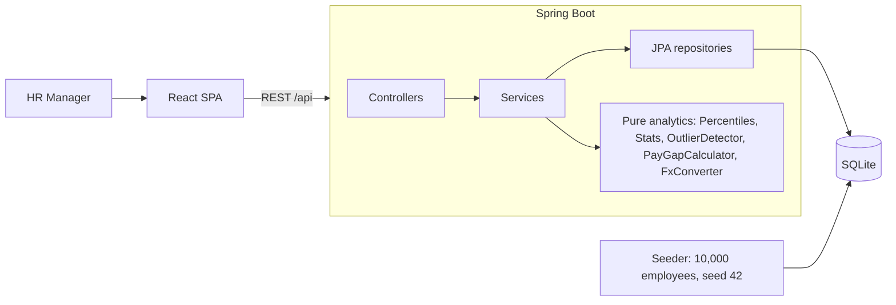

# Architecture

- One deployable: the built React app is served by Spring Boot as static files.
- `salary_usd` is persisted alongside local salary, so sorting and aggregates stay in SQL and fast.
- Salary changes only via `POST /employees/{id}/salary`, which appends an immutable history row.
- Analytics math lives in dependency-free static classes, unit-tested without a database.
